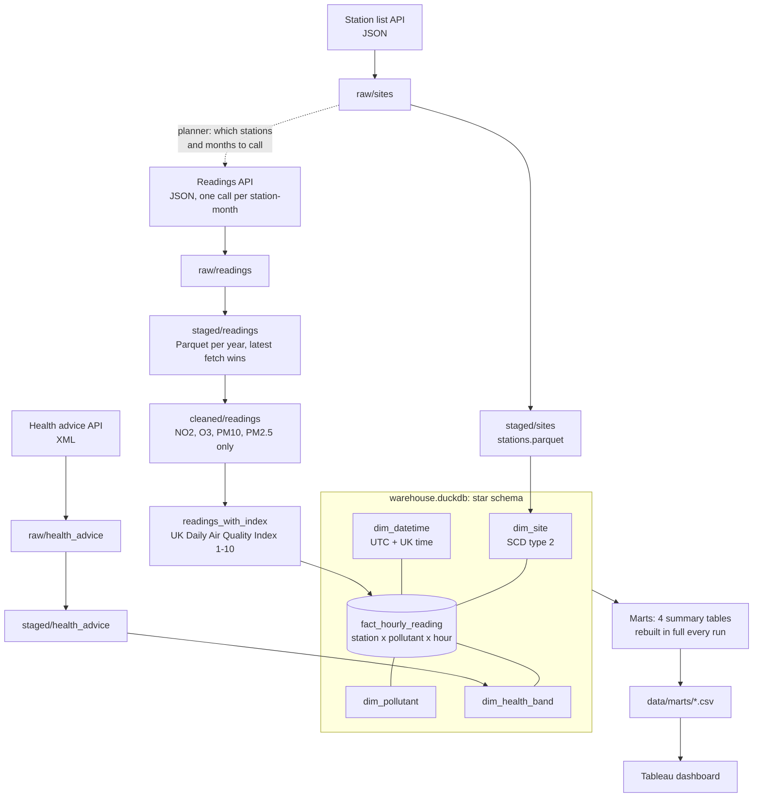

# Breathe Easy London

**When is London's air cleanest, and when is it riskiest, for people whose lungs are working hard?**

A data pipeline that turns 5 years of hourly air quality readings from the London Air Quality Network into a simple guide to the best and worst times and places to be active outdoors.

## The problem

ERG publishes what each air quality band means for your health, but only tells you the band **right now**. That helps someone decide what to do this hour. It doesn't help anyone **plan**: choose a training slot, advise a patient on a routine, or prepare for an outdoor event.

This project reconstructs the health band for every hour of the last five years, so the official advice becomes something people can plan around.

## Who it's for

**Primary users: people whose breathing is under load**
- People with respiratory conditions (asthma, COPD), whose lungs are more sensitive.
- People doing hard outdoor training (marathon, ultra, triathlon, Ironman), who breathe in several times more air than at rest, and so take in a bigger dose.

**Advisers who use it to guide others**
- GPs, respiratory nurses and sports medicine clinicians.
- Coaches and running or triathlon clubs.

## Questions the dashboard answers

The headline measure is **Share Moderate+**: the share of station-hours at index 4 or above, the level where official advice changes for people with lung or heart conditions.

1. **Which hours are worst?** Day of week × hour of day.
2. **Does the season matter?** Hour of day, by season.
3. **Is it getting better?** Share of stations with a Moderate+ day, by month. 
4. **Which boroughs are worst?**
5. **What kind of place is worst?** Roadside, kerbside, background, suburban, industrial.
6. **Which pollutant drives it?** NO2, O3, PM10, PM2.5.

Plus trust measures: how recent the data is, how many stations are open, and how many hours have a real reading.

## How it works



| Layer | What happens | Code |
|---|---|---|
| Extract | Three feeds from the ERG London Air API, saved untouched with the fetch time in the filename | `src/extract/` |
| Stage | Nested JSON/XML flattened to Parquet; for readings, the latest fetch of each hour wins | `src/transform/readings.py`, `sites.py`, `health_advice.py` |
| Clean | Keep the four pollutants the health index uses | `src/transform/clean.py` |
| Index | Official averaging (NO2 hourly, O3 8-hour, PM 24-hour, with a 75% data capture rule), then banded 1–10 | `src/transform/health_index.py` |
| Warehouse | Star schema in DuckDB; stations versioned (SCD type 2); only the last 16 days reloaded each run, in one transaction | `src/load/schema.py`, `warehouse.py` |
| Marts | Four small summary tables rebuilt in full each run and exported to CSV for Tableau | `src/load/marts.py` |

## Running it

```bash
pip install -r requirements.txt
python run_pipeline.py   # one-off backfill from 2021 (one API call per station-month, so slow)
python runner.py         # daily refresh: re-fetches the last 14 days, reloads, rebuilds marts
```

Both are safe to rerun: raw files are reused, and the warehouse load deletes and re-inserts its window, so nothing is counted twice.

## What's in the repo

| Folder | In the repo? |
|---|---|
| `data/raw/` (1.5 GB API cache) | No. Rebuilt by the backfill. |
| `data/warehouse.duckdb` (220 MB) | No. Over GitHub's file size limit; rebuilt by `runner.py`. |
| `data/staged/`, `data/cleaned/`, `data/marts/` | Yes, as a snapshot. `data/marts/*.csv` is what the dashboard reads. |

## Design decisions

- **Raw stays raw.** Each fetch is saved as received, with its fetch time in the filename, so any later step can be rerun without calling the API again.
- **Hour keys never change.** `datetime_key` is hours since 1970 UTC, so reloading an hour always gives the same key.
- **UK time worked out once.** UTC is converted to `Europe/London` in `dim_datetime`, so clock changes are handled in one place and "8am" on the dashboard really is 8am in London.
- **Delete and re-insert, not update.** A reading can move to a new station version (SCD type 2); updating in place would leave the old row behind and count that hour twice.
- **Marts store counts, not percentages,** so Tableau can add them up and divide (`SUM(top) / SUM(bottom)`) correctly at any level of filtering.
- **Station-months under 75% coverage are excluded** from every share, so a few hours from a mostly broken month can't skew a result.

## Findings

- Summer evenings are the worst time: around 7pm the Moderate+ share is several times the mid-morning level.
- Weekends are cleaner than weekdays.
- Spring has the highest share across the day; autumn the lowest.
- Particles (PM10, PM2.5) and ozone drive the Moderate+ hours. NO2 almost never reaches Moderate on the hourly index (see Limitations).

## Limitations

- **One station drives two charts.** LB5 (Lambeth, Industrial) is Moderate+ 28.9% of the time and is the only industrial station, so it puts both "Industrial" and "Lambeth" at the top.
- **"Open" means not formally closed**, not "reporting now". Some open stations stopped sending data years ago.
- **The daily index can't see NO2's main harm.** NO2 reaches Moderate only at 201 µg/m³ in a single hour; its health effect is long-term exposure, measured against an annual limit.
- **The index is reconstructed** from raw readings using the published rules, not taken from ERG's own published bands.

## Where AI helped
- Idea generation 
- exploratory analysis on data for file structure and staging logic
- Cleaning & documenting code
- Mart & tableau dashboard
- scraping and generating health index file from official site
- investigation of final data
- production of system flow diagram & README

## Next steps

- Compare conditions on major outdoor event days with a typical day.
- Count stations as "reporting" only if they sent data in the last 30 days.
- Store the index limits as a versioned table, so a future change to the bands can be applied to history.

## Data source

Readings, station list and health advice: [London Air Quality Network](https://www.londonair.org.uk/), Environmental Research Group, Imperial College London.
